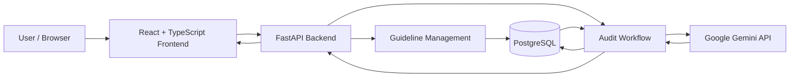
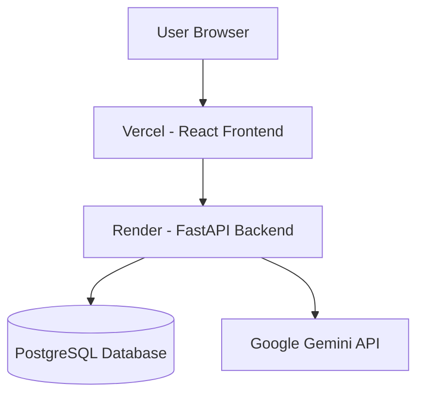

# High-Level Design (HLD)
## BrandShield AI — System Architecture

**Repository:** https://github.com/vishalkotapati5-glitch/BrandShield-AI

## 1. Purpose
This document describes the major components of BrandShield AI and how information moves between them.

## 2. System Context
BrandShield AI is a browser-based application. The frontend communicates with a Python FastAPI backend. The backend coordinates guideline and audit operations, calls Google Gemini for AI-assisted content analysis, and uses PostgreSQL for persistent application data.

## 3. Technology Stack

| Layer | Technology | Responsibility |
|---|---|---|
| Frontend | React | User interface |
| Frontend language | TypeScript | Typed frontend code |
| Backend | Python, FastAPI | API and application logic |
| Database | PostgreSQL | Persistent guideline and audit data |
| Database access | SQLAlchemy | Backend database interaction |
| Schema migrations | Alembic | Database schema migration management |
| AI integration | Google Gemini API | AI-assisted content analysis |
| Frontend hosting | Vercel | Frontend deployment |
| Backend hosting | Render | Backend deployment |

## 4. Logical Architecture

## 5. Component Responsibilities

### 5.1 Frontend
The React and TypeScript frontend provides:
- Dashboard and recent activity views.
- Brand guideline creation and management screens.
- Content submission and audit result views.
- Findings presentation.
- Human review actions.
- Audit history navigation.

### 5.2 Backend API
The FastAPI backend:
- Receives frontend requests.
- Validates and coordinates application operations.
- Reads and writes data through SQLAlchemy.
- Prepares guideline and content context for AI analysis.
- Returns findings and review state to the frontend.

### 5.3 AI Integration
The backend integrates with Google Gemini to analyse submitted content against relevant brand guideline context. Model output is used to produce audit findings. The model does not make the final human review decision.

### 5.4 Persistence Layer
PostgreSQL stores application information, including brand guideline data and audit/review history. SQLAlchemy provides database interaction, while Alembic manages schema migrations.

## 6. Key Data Flows

### 6.1 Guideline Management
1. User creates or updates a guideline in the frontend.
2. Frontend sends the operation to the backend API.
3. Backend validates and persists the guideline through SQLAlchemy.
4. Backend returns the result to the frontend.

### 6.2 Content Audit
1. User submits marketing content and relevant guideline context.
2. Frontend sends the audit request to FastAPI.
3. Backend retrieves required guideline information.
4. Backend sends content and guideline context to Google Gemini.
5. Backend interprets the response as findings.
6. Audit information is persisted and returned to the frontend.
7. Frontend displays severity, quoted text, explanations, and suggested corrections where available.

### 6.3 Human Review
1. Reviewer inspects the audit and findings.
2. Reviewer chooses approve, reject, or request changes.
3. Frontend sends the review action to the backend.
4. Backend records the review information.
5. Updated state is available in audit history.

## 7. Deployment View

The frontend and backend are deployed separately. Database connection details and Gemini credentials belong in deployment environment variables, not in Git.

## 8. Design Considerations
- **Separation of concerns:** UI, API logic, AI integration, and persistence have distinct responsibilities.
- **Human oversight:** AI output is guidance; final review is performed by a person.
- **Persistent history:** audit and review information is stored for later inspection.
- **External dependency:** AI auditing depends on Gemini availability and valid configuration.
- **Security limitation:** the described version does not include authentication or role-based access control; do not describe it as a secured multi-user production system.

## 9. Architecture Boundaries
This HLD describes the known logical architecture. Exact endpoint paths, database table/column names, cloud resource configuration, authentication controls, and network rules must be confirmed from the source code and deployment configuration before documenting them as facts.
