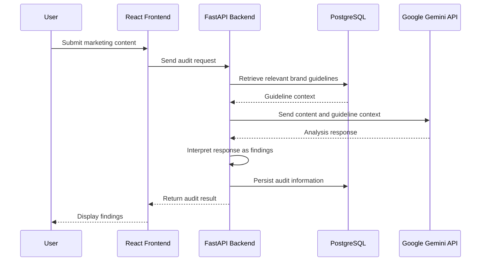
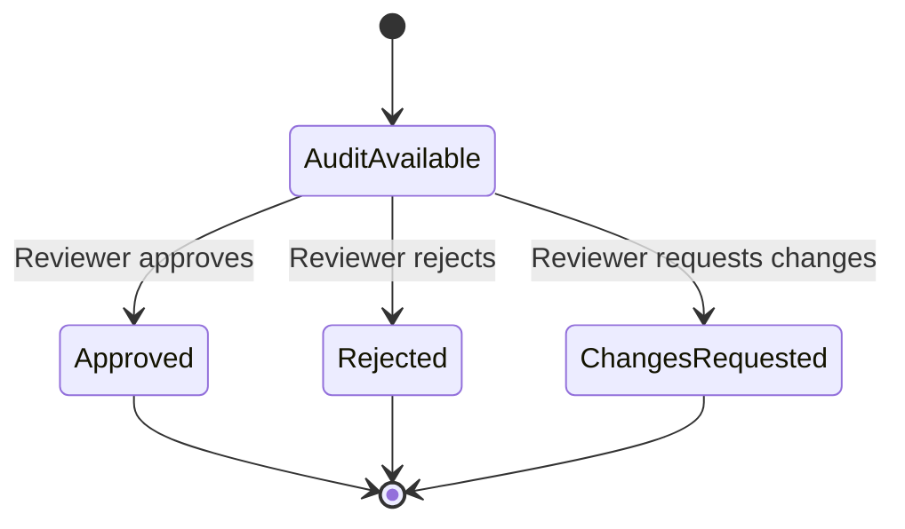

# Low-Level Design (LLD)
## BrandShield AI — Component and Workflow Design

**Repository:** https://github.com/vishalkotapati5-glitch/BrandShield-AI

## 1. Purpose
This document describes the main implementation-level responsibilities and workflows of BrandShield AI.

> **Accuracy note:** Exact route names, field names, SQL table names, and function signatures are not specified here unless confirmed from source code. Conceptual names below are not literal API paths or database identifiers.

## 2. Repository Areas

| Area | Responsibility |
|---|---|
| `frontend/` | React/TypeScript user interface |
| `backend/` | FastAPI application and backend logic |
| `docs/` | Project documentation |
| `docker-compose.yml` | Local multi-service/container orchestration configuration |
| `.env.example` | Example environment configuration; real secrets belong in local/deployment environment variables |

Confirm the current internal file and module names in the repository before adding more detailed references.

## 3. Frontend Design
The React and TypeScript frontend:
- Renders dashboard metrics and recent activity.
- Provides brand guideline management screens.
- Collects marketing content for an audit.
- Sends requests to the backend API.
- Displays audit findings, severity, and explanations.
- Presents human review actions.
- Shows audit history and updated review state.

The frontend should treat the backend response as the source of persisted application state. It should not claim that a review action was saved until the backend confirms it.

## 4. Backend Design

### 4.1 API Layer
- Accept frontend requests.
- Validate incoming data using the application's request validation.
- Invoke the relevant application operation.
- Return structured responses or appropriate errors.

### 4.2 Guideline Management
- Receive guideline creation and update operations.
- Apply backend validation.
- Persist guideline information using SQLAlchemy.
- Make relevant guideline information available to the audit workflow.

### 4.3 Audit Orchestration
- Receive submitted marketing content.
- Obtain relevant saved guideline context.
- Prepare analysis input for Gemini.
- Receive and interpret the model response.
- Make findings available to the frontend.
- Persist audit information for later review and history.

### 4.4 Review Workflow
- Receive the human review action.
- Record approve, reject, or request changes.
- Persist updated review information.
- Return the updated state to the frontend.

## 5. AI Audit Processing

This sequence is conceptual. It describes known processing responsibilities and does not assert exact route names or database operations.

### 5.1 Findings
The application presents AI-generated findings using information such as:
- Severity.
- Quoted or relevant content text.
- Explanation of the possible guideline issue.
- Suggested correction, when available.

AI output may be incomplete or incorrect and must be checked by a human.

## 6. Human Review Workflow

The diagram represents the available review decisions. It does not imply that a new audit is automatically created after changes are requested.

## 7. Logical Data Concepts

The following are logical concepts, not guaranteed literal SQL table names.

| Logical entity | Purpose | Example information |
|---|---|---|
| Brand Guideline | Stores rules used during auditing | Guideline content and associated metadata |
| Audit | Represents a submitted content audit | Submitted content, result, status, timestamps |
| Audit Finding | Represents an individual issue | Severity, quoted text, explanation, suggested correction |
| Review Decision | Records a human decision | Decision type and review information |

The application uses PostgreSQL for persistence and SQLAlchemy for database interaction. Alembic manages schema migrations. Confirm actual table names, columns, constraints, and relationships in backend models and migration files before documenting them as exact schema details.

## 8. Error and Dependency Considerations
- If Gemini is unavailable or returns an unusable response, the backend should not represent the audit as a successful completed analysis.
- Database errors should be surfaced through an appropriate API error response.
- Frontend loading and error states should distinguish a failed request from a completed audit.
- AI findings should remain distinguishable from the human review decision.
- API credentials and database passwords must be stored in environment variables or deployment secrets, not committed to Git.

These are design considerations. Verify the exact error handling in the current code before claiming every case is already implemented.

## 9. Technology and Supporting Tools
- React and TypeScript: frontend.
- Python and FastAPI: backend API.
- SQLAlchemy: database access.
- PostgreSQL: persistent storage.
- Alembic: database migrations.
- Google Gemini API: AI-assisted content analysis.
- Vercel: frontend hosting.
- Render: backend hosting.
- Docker Compose: local service orchestration configuration.

## 10. Verification Checklist
Before treating this LLD as a final implementation record, verify against the repository:
- [ ] Actual FastAPI route paths and HTTP methods.
- [ ] Actual request and response schemas.
- [ ] Actual SQLAlchemy model and table names.
- [ ] Actual foreign-key relationships and constraints.
- [ ] Actual Gemini prompt construction and response parsing.
- [ ] Actual exception handling and validation behaviour.
- [ ] Actual review-state values and persistence logic.
- [ ] Actual Docker Compose services and environment variables.

Adding verified details will make the LLD more precise without inventing implementation facts.
